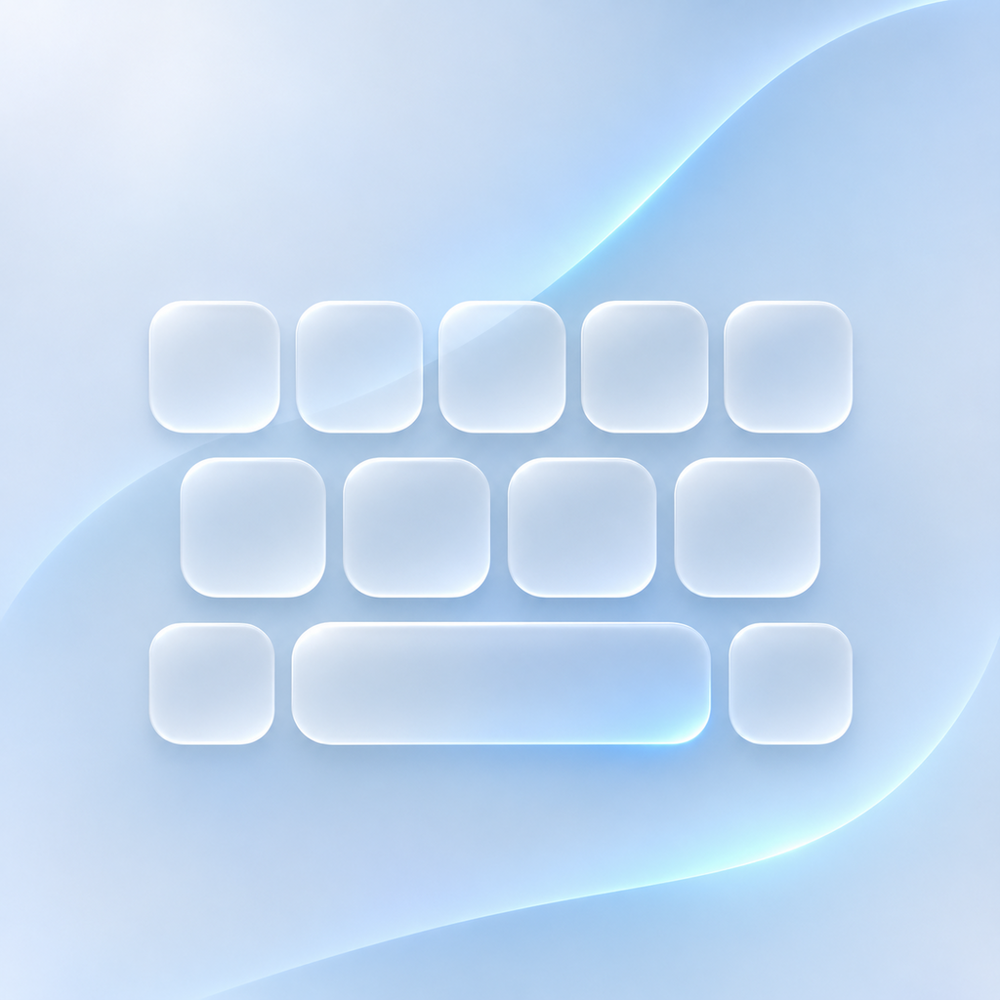

<picture>
  <source media="(prefers-color-scheme: dark)" srcset="App/Assets.xcassets/AppIcon.appiconset/AppIcon-Dark.png">
  
</picture>

# GlassType

**Открытая офлайн-клавиатура для iPhone: Swift, UIKit и три языка.**

GlassType сочетает мягкую геометрию Material 3 с полупрозрачными поверхностями и системным материалом iOS. Проект состоит из приложения настроек и настоящего Keyboard Extension: клавиатуру можно выбрать в iOS и использовать в приложениях, допускающих сторонние клавиатуры.

EN / RU / UK · светлая и тёмная темы · свайп-ввод · локальные словари · без рекламы и сетевых запросов

[Исходники](https://github.com/alexlark920-web/GlassType) · [Сборки GitHub Actions](https://github.com/alexlark920-web/GlassType/actions/workflows/build-ios.yml) · [Результаты проверок](Docs/CHECK_RESULTS.txt) · [Архитектура ввода](Docs/TOUCH-INPUT.md) · [Отзывчивость 1.7 и источники](Docs/RESPONSIVENESS-1.7.md)

## Статус проекта

GlassType находится в активной разработке. Текущая линия исходников — **1.16**; номер сборки назначает GitHub Actions при каждом запуске. Это рабочая системная клавиатура с экспериментальным непрерывным вводом, которой ещё предстоит полноценная проверка на разных устройствах и в разных приложениях. CI собирает неподписанный IPA с Keyboard Extension; при настройке секретов и Variables можно также публиковать бинарные релизы и SideStore-источники в отдельный репозиторий.

Проверяемая конфигурация сборки — **Xcode 26.3**; минимальная версия системы в проекте — **iOS 16**. Совместимость и ощущения от набора на физическом устройстве с iOS 27 нужно проверять отдельно. Ссылки на выполненные тесты, сборку для симулятора и архив конкретной версии находятся в [отчёте проверки](Docs/CHECK_RESULTS.txt).

## Возможности

### Текст и языки

- Английская, русская и украинская раскладки; языки можно включать и отключать в приложении или прямо в меню клавиатуры. Минимум один язык остаётся активным; последний выбранный язык сохраняется.
- Обычный ввод с отслеживанием пальца до отпускания: короткое скольжение может выбрать соседнюю букву, дрожание у границы подавляется.
- Backspace удаляет символ при первом касании, а удержание запускает повтор после короткой задержки 90 мс с постепенным ускорением; короткое нажатие после свайп-слова по-прежнему отменяет целое последнее слово.
- Заглавная буква в начале текста и предложения: состояние обновляется непосредственно перед вводом; пустое поле проверяется отдельно от отсутствующего контекста.
- Для свайпа и подсказок одиночный Shift делает заглавной первую букву слова; Caps Lock — всё слово.
- Две страницы цифр и знаков: `123` и `#*=`.
- Дополнительные символы удержанием, включая `ё`, `ґ` и диакритику. Можно отдельно отключить дополнительные знаки и их маленькие метки на клавишах.
- Частотные подсказки, автозамена при пробеле, Enter или знаке препинания и её отмена Backspace сразу после замены. Кандидаты оцениваются по частотному рангу и типу опечатки; близкие варианты сохраняют исходное слово. Если введённого слова нет в корпусе и нечего предложить, верхняя строка позволяет сохранить текущую форму в личный словарь; сохранённые слова затем участвуют в подсказках и не исправляются автокоррекцией.
- Личный словарь ручных замен, пользовательских слов и списка слов, которые не нужно исправлять.
- Дополнительный офлайн-слой современных разговорных слов и сленга на EN/RU/UK. Нецензурные слова по умолчанию исключены из подсказок и кандидатов автозамены; настройка «Разрешить нецензурные слова в подсказках и автозамене» включает их отдельно. Фильтр применяется также к системным догадкам и личным заменам. Перечень подобран вручную и конечен, поэтому он не является универсальным модератором и может не распознавать новые написания.
- Двойной пробел для точки, удаление слова свайпом по Backspace и кнопка возврата удалённого слова.
- Дополнительный выбор клавиши со смайликом вместо глобуса и офлайн-каталог Unicode Emoji 18.0: 3 963 полноформатные последовательности и 9 составных компонентов. Вся сетка доступна горизонтальной прокруткой, категории служат быстрыми фильтрами; есть локальный поиск по Unicode-названиям, русским и украинским псевдонимам. Поиск вводится самой клавиатурой и не меняет текст в приложении; `ABC` возвращает к буквам. Внешний вид новых emoji зависит от версии шрифта iOS.
- Язык интерфейса приложения и меню клавиатуры: русский, English и українська.

### Непрерывный ввод

Слово можно провести пальцем по буквам. Распознаватель учитывает исходную точку касания, геометрию текущей раскладки, форму траектории и частотный порядок слов. В панели подсказок доступны альтернативы распознанному слову.

Следующие нажатия ждут фонового распознавания и выполняются по порядку. Короткий Backspace сразу после свайпа удаляет распознанное слово целиком; удержание сначала удаляет один символ, затем стирает дальше. После свайпа или выбора подсказки пунктуация вставляется без лишнего автоматического пробела. Самостоятельно введённые пробелы не удаляются. След пальца ограничен 95 мс и примерно 2,2 шагами клавиши, толщина — 4,5 pt.

Удержание пробела включает перемещение курсора: горизонтальное движение ускоряется по мере удаления пальца от точки захвата. Если палец продолжает удерживаться за левым или правым краем клавиши (вплоть до края экрана), курсор продолжает двигаться повторными шагами; отпускание и отмена касания немедленно останавливают повтор.

В проект встроены **87 474 слов и словоформ**:

| Язык | Записей |
| --- | ---: |
| English | 30 046 |
| Русский | 30 088 |
| Українська | 27 340 |

Один корпус используется для подсказок, кандидатов автозамены и свайпа. Все данные поставляются вместе с клавиатурой: первоначальная загрузка из сети не требуется. Украинская часть частотного корпуса прошла орфографическую проверку при подготовке; дополнительно включена современная лексика, связанная с клавиатурами и программами.

Свайп пока экспериментальный. Это локальный геометрический декодер с частотным ранжированием, без большой контекстной языковой модели. Необычные слова, имена и сложные траектории могут распознаваться неверно. Контрольные траектории «hello», «привет», «как» и украинских слов проверяются модульными тестами; реальный набор пальцем требует отдельной проверки. При включённой персонализации клавиатура дополнительно ранжирует словарные подсказки и автозамену по агрегированным локальным счётчикам предыдущих слов. Профиль ограничен, хранится только в контейнере расширения и сбрасывается из настроек. Полные сообщения, пароли, история набора и сырые касания не сохраняются. Детали и ограничения — в [описании локального предсказания](Docs/LOCAL-PREDICTION.md).

### Дизайн и отклик

У приложения есть светлая и тёмная стеклянные иконки. Их вид выбирается оформлением значков домашнего экрана iOS и не зависит от темы самой клавиатуры. [Устройство иконки](Docs/APP-ICON.md).

- На iOS 26+ — системный `UIGlassEffect` на клавишах в общем `UIGlassContainerEffect`: преломление, адаптивные блики и нейтральное тонирование. На старых системах — полупрозрачные плашки с тонким контуром; при повышенном контрасте или уменьшении прозрачности используется более чёткое оформление.
- Светлая, тёмная и системная темы.
- По умолчанию все четыре ряда занимают одинаковую ширину и имеют совпадающие левые и правые границы. В языках, где в рядах разное число символов, ширина клавиш внутри каждого ряда распределяется отдельно; короткие ряды не смещаются в сторону.
- Настраиваемые ползунки высоты клавиатуры и видимой ширины клавиш. Ширина меняет только плашки: области касания и расстояния между их центрами остаются неизменными. Границы настроек ограничены, чтобы сохранить четыре ряда и зоны нажатия.
- Видимые промежутки между клавишами включены в распознавание касаний.
- Лёгкое движение текстовых клавиш при нажатии. Нижний ряд, Shift и Backspace остаются на месте.
- Настраиваемый тактильный отклик; его доступность зависит от устройства и ограничений iOS.
- Увеличенный символ над клавишей — отдельная настройка.
- Монохромный Shift с контурным, залитым и Caps Lock состояниями.
- Настройки с системными переключателями UIKit и фоном, согласованным с клавиатурой.
- Поддержка системных параметров уменьшения движения и прозрачности, повышенного контраста и действий VoiceOver.

Системный `UIInputView` обеспечивает основу фона. Область под клавиатурой, системный глобус и микрофон контролирует iOS; их оформление зависит также от приложения-хоста.

### Точность касаний

Видимая плашка и область распознавания разделены. Общий координатный слой сравнивает касание с центрами клавиш, вычисляет геометрические вероятности и однозначно выбирает получателя. Служебные кнопки защищены собственными зонами.

**Адаптация касаний отключена по умолчанию.** После включения она постепенно учитывает устойчивое общее смещение пальца, отдельно в портретной и альбомной ориентациях. Размеры и расположение плашек при этом сохраняются. Адаптацию можно отключить и полностью сбросить. Отдельная настройка локального обучения подсказок по умолчанию включена: ограниченный n-граммный профиль содержит агрегированные счётчики переходов между короткими контекстами и словами, а не последовательность сообщений. Он работает отдельно для EN/RU/UK, остаётся на устройстве, отключается и сбрасывается. Это компактная статистическая модель, а не Core ML нейросеть; ни готовая нейросетевая модель, ни большой языковой корпус последовательностей в проект не включены.

Для проверки есть отладочный показ фактических зон касаний и центров клавиш. Подробности алгоритмов и ограничений — в [описании системы ввода](Docs/TOUCH-INPUT.md).

## Жесты и управление

| Действие | Результат |
| --- | --- |
| Нажатие глобуса в ряду клавиш | Смена языка GlassType |
| Нажатие смайлика, если включена его кнопка | Открыть эмодзи; строка `ABC` возвращает к буквам |
| Удержание глобуса или смайлика | Настройки клавиатуры |
| Быстрый свайп по пробелу влево или вправо | Следующий или предыдущий язык |
| Удержание пробела и движение в стороны | Горизонтальное перемещение курсора |
| Двойное нажатие Shift | Caps Lock |
| Удержание буквы или знака | Выбор дополнительного символа |
| Свайп влево по Backspace | Удаление слова, если функция включена |
| Короткий Backspace сразу после свайп-слова | Удаление последнего распознанного слова целиком |
| Движение по буквам без отрыва | Свайп-ввод, если функция включена |

Системная кнопка переключения на другие клавиатуры iOS сохраняется отдельно. Удержания и жесты имеют альтернативные действия для VoiceOver там, где они предусмотрены интерфейсом.

## Приватность и офлайн-работа

- В коде клавиатуры нет сетевого клиента, аналитики, рекламы или загрузки словарей при запуске.
- Набранные сообщения, последовательности нажатий и пароли не записываются в постоянное хранилище.
- Адаптивная калибровка touch-модели использует только числовые агрегаты: количество устойчивых образцов, среднее смещение и разброс для каждой ориентации. По ним постепенно корректируются центр и ширина вероятностной зоны касания; нет букв, ID клавиш, документов, временных меток и истории координат. Это ограниченное статистическое обучение распознаванию касаний, а не языковая модель; оно не учит слова и не меняет автозамену. Адаптацию можно выключить и сбросить.
- Защищённые поля и другие неподходящие контексты исключены из адаптации. В secure-полях iOS обычно сама подставляет системную клавиатуру.
- Ручные записи личного словаря хранятся на устройстве по явному действию пользователя. При включённом полном доступе приложение и расширение используют App Group для общих настроек и синхронизации словаря; без разрешения остаётся локальная копия в контейнере клавиатуры.
- Ограниченный контекст поля и траектория текущего свайпа обрабатываются временно в памяти для ввода; они не превращаются в журнал сообщений.

**«Полный доступ» не нужен для ввода, поиска emoji, встроенных словарей, автозамены, свайпа, тактильного отклика или адаптации касаний.** Он используется для App Group — общих настроек приложения и синхронизации личного словаря. Без разрешения настройки и словарь работают из локального контейнера расширения. Клавиатура не следит за буфером обмена и не предоставляет отдельную кнопку вставки. `RequestsOpenAccess=true` сохранён только для App Group; включить разрешение может только пользователь в iOS. Сетевого кода нет.

Полный каталог основан на официальном файле Unicode Emoji 18.0; источник, атрибуция, команда генерации и ограничение по поддержке глифов описаны в [Docs/Unicode-Emoji.md](Docs/Unicode-Emoji.md). UIKit не позволяет запрашивать внутреннюю базу эмодзи установленной версии iOS, поэтому каталог включает стандарт Unicode 18.0; на более старых версиях системы некоторые новые glyph могут выглядеть иначе или не поддерживаться.

После переподписи через SideStore общая App Group может быть недоступна. Поэтому настройки внутри клавиатуры сохраняются отдельно и работают без неё; локальные значения имеют приоритет над общими. Поле ввода настроек не может гарантировать одинаковый `keyboardType` во всех приложениях. GlassType отключает автокоррекцию в известных полях email, URL, телефона и чисел, но не подменяет неизвестные хост-раскладки.

## Установка готовой IPA через SideStore

1. Откройте [GitHub Actions](https://github.com/alexlark920-web/GlassType/actions/workflows/build-ios.yml) в браузере и выберите последнюю **успешную** сборку нужной версии. Для приватного репозитория потребуется вход в GitHub.
2. В разделе **Artifacts** скачайте IPA-артефакт с каналом и версией в названии. В ZIP лежит готовый `.ipa` файл.
3. В настроенном SideStore нажмите `+` и выберите IPA. При запросе расширений выберите **Keep App Extensions (Register App ID for Each Extension)**: расширение и является системной клавиатурой.
4. Откройте GlassType, затем добавьте клавиатуру: **Настройки iOS → Основные → Клавиатура → Клавиатуры → Новые клавиатуры → GlassType**.
5. Переключитесь на неё системным глобусом. Для настройки удерживайте глобус в ряду самой GlassType.

Обновление устанавливается поверх существующей GlassType с сохранением расширения. Неподписанная IPA требует переподписи SideStore. Если публичный репозиторий распространения настроен, добавьте отдельный Stable или Beta AltSource в SideStore и устанавливайте обновления из него. Публичный репозиторий содержит только IPA, AltSource JSON, графическую иконку и release notes, не исходный код.

## Сборка из исходников

Нужен Mac с Xcode и iOS SDK либо macOS-исполнитель GitHub Actions. На Windows можно редактировать проект и запускать облачную сборку; для установки готовой IPA Mac не требуется.

Откройте `GlassType.xcodeproj`, выберите схему `GlassType`. В проекте два target: приложение `GlassType` и встроенное расширение `GlassTypeKeyboard`. Зависимость `KeyboardCore` подключена как локальный Swift Package без внешних runtime-зависимостей.

Проверка структуры:

```sh
python3 Scripts/validate_project.py
```

Модульные тесты и сборка для iOS Simulator на Mac:

```sh
bash Scripts/check-macos.sh
```

Архив устройства и неподписанная IPA:

```sh
bash Scripts/make-unsigned-ipa.sh
```

Результат: `build/GlassType-unsigned.ipa`. Скрипт проверяет наличие Keyboard Extension и всех трёх словарей внутри него.

Облачный workflow запускается при PR (проверки без публикации), push в `main` (Beta), теге `vX.Y.Z` (Stable) и вручную с выбором канала. Он проверяет структуру, запускает XCTest и simulator build, затем создаёт неподписанный device IPA с вложенной клавиатурой. При заданных `DISTRIBUTION_REPOSITORY` и `DISTRIBUTION_TOKEN` IPA публикуется в отдельный публичный репозиторий, а его AltSource JSON обновляется с проверкой официальной схемы SideStore. Настройка описана в [руководстве распространения](Docs/SIDESTORE_DISTRIBUTION.md).

Чтобы выпустить следующую сборку, увеличьте `CFBundleShortVersionString` и `CFBundleVersion` одновременно в `App/Info.plist` и `Keyboard/Info.plist`. `Scripts/package_source.py` создаёт ZIP, имя которого строится из этих значений.

## Устройство проекта

| Каталог | Назначение |
| --- | --- |
| `App/` | Приложение настроек, подключение клавиатуры, поле проверки |
| `Keyboard/` | `UIInputViewController`, кнопки, координатная поверхность, жесты, UI-вставки и UIKit-адаптер текста |
| `Core/Sources/KeyboardCore/` | Раскладки, геометрия, вероятности касаний, калибровка, словари, `CandidateGenerator`, `PredictionEngine`, n-граммный профиль, политика автозамены и декодер свайпа |
| `Core/Sources/KeyboardCore/Resources/` | Встроенные словари, контрольные суммы и лицензии данных |
| `Core/Tests/KeyboardCoreTests/` | Модульные тесты ввода, раскладок, границ, адаптации и декодирования |
| `Shared/` | Общие настройки и локальное хранение параметров расширения |
| `Scripts/` | Проверки проекта и IPA, управление CI-версиями, SideStore AltSource и упаковка |
| `Docs/` | Архитектура, руководство SideStore, история изменений и результаты проверки |

Геометрическая вероятность одиночного нажатия отделена от языкового ранжирования слов. `PredictionEngine` выдаёт ограниченный набор словарных кандидатов, а персональный n-граммный профиль может повлиять на их порядок и на консервативную автозамену. Он не меняет геометрический выбор клавиши. Изменение уже введённого слова выполняет отдельный механизм автозамены с проверкой контекста и возможностью отмены.

## Ограничения и дальнейшая работа

- Приложение-хост может запретить сторонние клавиатуры; защищённые и некоторые телефонные поля обслуживает iOS.
- Расширение получает частичный контекст, который может отсутствовать. Это ограничивает подсказки, автозамену и распознавание границ документа.
- Публичные API не дают полностью воспроизвести системный трекпад, диктовку и управление системной нижней панелью. Курсор GlassType перемещается по горизонтали.
- Emoji-поиск использует встроенные Unicode-названия и небольшой набор русских/украинских псевдонимов; полной локализации названий всего Unicode-каталога пока нет. Сетка включает каталог Emoji 18.0, но не историю часто используемых emoji. Голосовой ввод остаётся системным.
- iOS и хост-приложение могут не сообщать расширению достаточно сведений, чтобы надёжно переключить видимые клавиши для email, URL, телефона и числа. Поэтому отдельные раскладки для этих полей не имитируются; проверяется только ограничение автокоррекции по публичному `keyboardType` и secure-флагу.
- Словари являются базовыми частотными корпусами со словоформами. Автозамена намеренно отказывается от неоднозначных случаев.
- Реальные задержки, расход памяти, энергия и точность быстрого набора требуют проверки на устройствах; модульные тесты не заменяют её.

Следующие направления — ручная проверка точности свайпа и многопальцевого набора, измерения Instruments и проверка интерфейса на актуальных версиях iOS. Локальная статистика предсказаний ограничена и может быть полностью сброшена; размеры и производительность модели описаны без неподтверждённых оценок в [Docs/LOCAL-PREDICTION.md](Docs/LOCAL-PREDICTION.md).

Для отчёта об ошибке полезны модель iPhone, версия iOS и GlassType, язык, ориентация, приложение и точные шаги воспроизведения. Не прикладывайте пароли и личные сообщения; лучше использовать короткий выдуманный пример.

## Лицензии

Код GlassType распространяется по [MIT License](LICENSE).

Частотные данные основаны на FrequencyWords / Hermit Dave и OpenSubtitles2018 / OPUS; адаптированные словари — **CC BY-SA 4.0**. Для подготовки украинского списка использован Hunspell-совместимый словарь LibreOffice / dict_uk. Источники, изменения и полные тексты лицензий включены в [ресурсы словарей](Core/Sources/KeyboardCore/Resources/Dictionary-Attribution.txt). Их можно прочитать и в основном приложении, в разделе «Лицензии словарей».

Подготовка данных воспроизводится через `Scripts/build_lexicons.py` из источников с проверкой Git blob hashes и `Scripts/lexicon_supplements.json`. Python и инструмент проверки используются при подготовке данных; для работы iOS-клавиатуры они не нужны.

---

**English overview:** GlassType is an open-source, offline iPhone keyboard built with Swift, UIKit and a dedicated Keyboard Extension. It supports English, Russian and Ukrainian, adaptive key geometry, probabilistic touch recognition, optional anonymous touch calibration, local correction and experimental glide typing. The project is under active development; device compatibility and release readiness are documented separately from build results.
